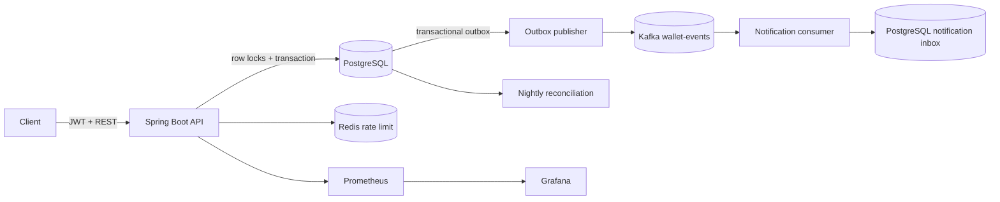
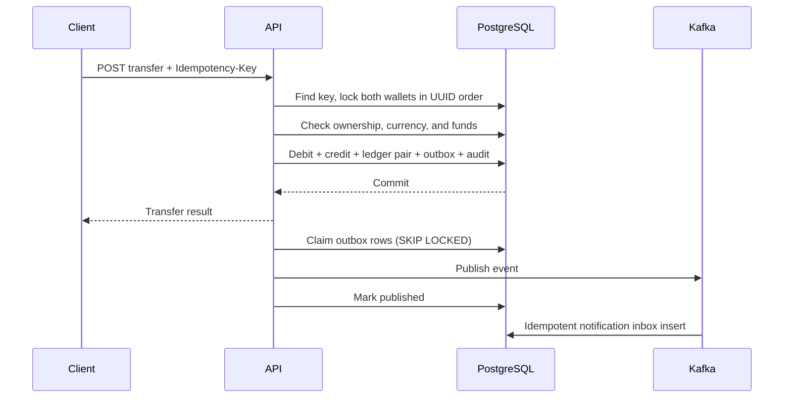

# Payment Wallet Service

Java 25 LTS / Spring Boot wallet API backed by PostgreSQL. Money is `BIGINT` minor units; the API accepts integer paise/cents only.

## Run

```sh
docker compose up --build
```

The API listens on `http://localhost:8080`; PostgreSQL, Redis, and single-node Kafka are included. Add `--profile monitoring` for Prometheus (`:9090`) and Grafana (`:3000`, `admin` / `admin`). Local compose credentials and signing key are for development only.

Mint a one-hour local development token for a UUID subject:

```sh
export USER_ID=11111111-1111-4111-8111-111111111111
export TOKEN="$(python3 scripts/token.py "$USER_ID")"
curl -s localhost:8080/v1/wallets -H "Authorization: Bearer $TOKEN" -H 'Content-Type: application/json' -d '{"currency":"INR"}'
```

Copy the returned wallet ID into `WALLET_ID`, then fund it once for local transfer demos:

```sh
export WALLET_ID="paste-wallet-id-here"
curl -s -X POST "localhost:8080/v1/wallets/$WALLET_ID/deposit" -H "Authorization: Bearer $TOKEN" -H 'Content-Type: application/json' -H 'Idempotency-Key: demo-fund-once' -d '{"amountMinor":100000}'
```

The token helper signs claims with the local HMAC secret. It is a development identity stub, not account registration or production identity proof. Set a random `JWT_SECRET` before exposing the service.

## API

All `/v1` endpoints require `Authorization: Bearer <JWT>`. The JWT `sub` is the owner's UUID.

| Method | Path | Notes |
|---|---|---|
| POST | `/v1/wallets` | `{"currency":"INR"}` |
| GET | `/v1/wallets/{id}` | Owner-scoped balance |
| POST | `/v1/wallets/{id}/deposit` | `Idempotency-Key`; simulated funding: `{"amountMinor":10000}` |
| POST | `/v1/transfers` | `Idempotency-Key`; `{ "fromWallet":"…", "toWallet":"…", "amountMinor":100 }` |
| GET | `/v1/transfers/{id}` | Transfer result, visible to either wallet owner |
| GET | `/v1/wallets/{id}/ledger?limit=50&before=9223372036854775807` | Cursor pagination |

Transfers return `201` when completed and `422` when persisted as failed for insufficient funds. Repeating a transfer key with the same payload returns the original result; changing the payload returns `409`. Deposit keys prevent repeated credits, and the endpoint returns the wallet's current balance. Limits are 100 ledger rows per page and 120 authenticated API calls per user per minute by default.

## Architecture





## Correctness and trade-offs

- **Ledger:** each transfer posts equal debit and credit entries; deposits credit the wallet and debit a `CASH_CLEARING` system account. Wallet balances reconcile to wallet-specific ledger entries. Entries are append-only by application convention; the service never updates/deletes them.
- **Locking:** pessimistic `SELECT … FOR UPDATE` is used. Both wallet rows are always locked by ascending UUID, preventing opposite-direction transfer deadlocks. A `CHECK (balance_minor >= 0)` is the final guard. The schema has no optimistic path today; compare it only after implementing a version-checked update path and run both against identical workloads.
- **Isolation:** PostgreSQL `READ COMMITTED` plus row locks serializes balance changes for the touched wallets; unrelated wallets remain concurrent. Serializable transactions are appropriate when adding predicates spanning many rows that cannot be protected by these row locks.
- **Idempotency:** PostgreSQL unique constraint is authoritative. `INSERT … ON CONFLICT DO NOTHING` resolves parallel submissions without leaving the transaction aborted. Redis is reserved for rate limiting; it is not an idempotency source of truth.
- **Caching:** wallet balances are read directly from PostgreSQL; caching money state without a complete invalidation protocol risks stale balances. Add a cache only if measurements justify the consistency cost.
- **Events:** wallet update, ledger, audit, and outbox rows commit together. Publisher uses `SKIP LOCKED`; a crash after Kafka publish but before marking can duplicate a message. Notification inbox deduplicates by outbox event ID, giving at-least-once delivery with an idempotent consumer.
- **Rate limiting:** Redis increments a per-user/minute counter. This demo fails open during Redis outages; production policy should choose and monitor fail-open/fail-closed behavior explicitly.

## Tests and load measurement

```sh
mvn test                 # Testcontainers requires Docker
RATE_LIMIT_PER_MINUTE=100000 docker compose up --build # raise the per-user cap for this throughput run
k6 run loadtest/transfers.js -e TOKEN=... -e SOURCE_WALLET=... -e TARGET_WALLET=...
```

| Run | Environment | VUs | Duration | TPS | p50 | p95 | p99 |
|---|---|---:|---:|---:|---:|---:|---:|
| Not measured | — | — | — | — | — | — | — |

No throughput number is claimed until the workload is run on a recorded machine and database configuration. The k6 setup funds the source wallet before the run. Testcontainers covers 50 same-key retries, 1,000 parallel transfers, same-key deposits, insufficient-funds idempotency, and a forced database failure to check rollback. A process-kill recovery test is still needed before treating this as production-grade.

GitHub Actions runs package and Testcontainers tests on each push/PR. Prometheus scrapes Spring Actuator metrics at `/actuator/prometheus`.

## Next

This is a portfolio service, not a regulated-money system: demo JWT issuance, simulated deposits, single-currency wallets, one Kafka broker, and no fraud controls or external payment rail. Next steps: a real identity provider, durable outbox leasing/retry metrics, multi-currency accounting, refunds as compensating entries, fraud limits, database backups, and measured optimistic-vs-pessimistic benchmarks. Shard only after measured database contention warrants it.
